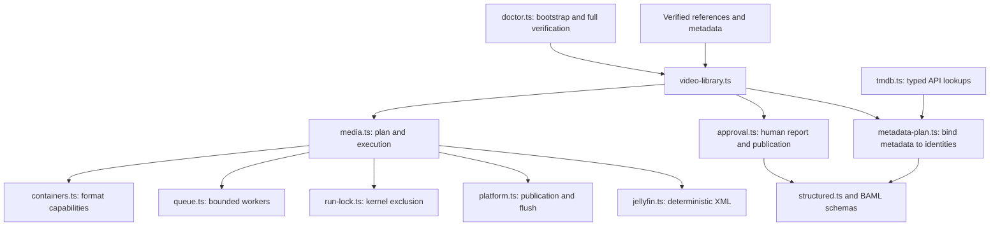
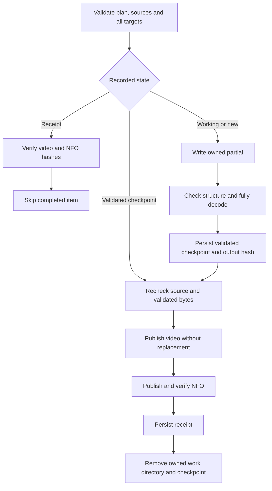

# Scripts and types

Implementation guide. The operating procedure is in [SKILL.md](../SKILL.md); the human approval contract is in [approval-plan.md](approval-plan.md). Command syntax comes from CLI `--help`.

## Module map

| Module | Responsibility |
| --- | --- |
| `doctor.ts` | Bootstrap and update packages, generate BAML code, check real executables and TMDB access, run typed lint, Bun typecheck and parallel test files, then run the Jellyfin integration. |
| `video-library.ts` | CLI arguments, inventory, generated approval artifacts and explicit execution/cleanup gates. |
| `media.ts` | Catalog and execution validation, hashes, stream selection, remuxing, full decoding, durable records, recovery and cleanup preflight. |
| `containers.ts` | Supported extensions, muxers, metadata capabilities and known track/chapter restrictions. A mislabeled source extension fails planning. |
| `metadata-plan.ts` | Validate supplied metadata, match its identity to the catalog, reject sidecar collisions and provide identity-only defaults. |
| `jellyfin.ts` | Escape XML, render movie/episode sidecars and calculate their hashes. |
| `tmdb.ts` | Credential-safe API checks and confirmed-ID lookups through `@lorenzopant/tmdb`. Save metadata before approval; execution makes no API calls. |
| `structured.ts` | Local BAML decoding. Generated bridge types replace a second handwritten approval/metadata schema. No LLM client is configured. |
| `queue.ts` | Physical-core discovery and work-conserving file queues. |
| `run-lock.ts`, `platform.ts` | OS-specific exclusion, free space, non-replacing publication and durability limits. |
| `jellyfin-e2e.ts` | Synthetic CLI plan/apply/verify followed by real Jellyfin NFO import into a disposable instance. Wait for complete metadata, not merely visible item names. |

Paths above are under `scripts/`. BAML definitions live in `baml_src/main.baml`; `baml_sdk/` is generated and ignored.

## Data contracts

`Catalog` is a union. `TvCatalog` carries the show, season, episode-list reference, full episode list and layout. `MovieCatalog` carries explicit source-relative filenames, titles, years and references. The chosen catalog accounts for existing destination entries too. Both accept an explicitly requested container and confirmed language overrides. Raw FFprobe data stays unchanged; `effectiveProbe` applies language overrides to a copy for selection.

`Plan` version 2 binds roots, catalog, approved job count, items, completeness and creation time. Each `Item` records source, target, title, source SHA-256, raw `Probe`, selected stream indices and optional validated `JellyfinMetadata`. `loadPlan` checks structure and recomputes mappings. Older plan formats must be regenerated and approved, not hand-edited.

`ApprovalPlan` is generated from execution data and decoded by BAML before rendering. Its digest uses recursively sorted object keys, preserving array order. Formatting JSON differently does not change identity; changing jobs, metadata or mappings does. Apply compares the approved report digest before opening the run.

`JellyfinMetadata` holds display identity, provenance, provider IDs and optional descriptive fields. XML generation rejects characters XML 1.0 cannot represent. A source-relative metadata map can enrich the catalog identity but cannot silently identify a different movie or episode.

## Per-file recovery

The run directory contains:

- `run.json`, binding the canonical plan digest.
- `item-<source-path-hash>.checkpoint.json`, binding the plan, source, target, owned work directory and `working` or `validated` stage.
- `item-<source-path-hash>.json`, recording source/output hashes, the full-decode result and the NFO hash when applicable.
- Per-file FFmpeg logs. Linux also keeps the persistent `apply.lock` inode.

A working partial has no trusted completion proof and restarts. A validated partial can be reused only after hash and structure checks. If video publication finished before a crash, its matching checkpoint can recover NFO publication and the receipt without another remux. A receipt left with its checkpoint is verified before tidying. Corrupt final files fail instead of being overwritten or repaired silently.

Apply preflights every source and target before starting work, including case-insensitive NFO collisions. It repeats per-file safety checks near publication. Validation checks selected codecs, dimensions, channels, supported metadata, chapters and duration, followed by a full audio/video decode. File SHA-256 binds the checked bytes to the receipt.

Cleanup requires the manifest and exact plan, verifies every video and sidecar, flushes outputs and records, then rechecks each source before removal. Deletion is not a transaction across the batch; interruption can leave some originals already removed. Source directories and unrelated files remain.

## Concurrency and platforms

The queue default and ceiling are `max(4, floor(physical cores / 2))`. Linux counts package/core pairs within process affinity; Windows queries `Win32_Processor.NumberOfCores`. Unavailable topology falls back to one physical core before applying the floor. The plan stores the approved limit. Execution can lower it, never increase it. FFmpeg retains native multithreading.

Queues preserve result order, fill free slots and stop claiming work on the first failure while awaiting active tasks. Ordered flushes and bounded worker loops deliberately await sequential operations.

Linux holds `flock` through a parent-owned file descriptor. Publication uses GNU `mv` with no copy, replacement or target-directory fallback. Windows uses a single-instance named pipe and native `MoveFileExW` without replacement or cross-volume copy permission. PowerShell receives paths as decoded UTF-16LE Base64 data, including smart quotes and shell metacharacters.

Windows native behavior has source review, not machine validation. Its directory-publication durability is unproven, so automatic cleanup is blocked even after confirmation. File hashes and process-crash recovery do not establish protection against every device or filesystem failure.

## Verification and lint

`bun run doctor` is the full verification command. Missing external tools fail rather than skip coverage. The isolated Jellyfin test checks distinct flat-movie sidecars and episode metadata, with Internet providers disabled. See [Jellyfin reference](jellyfin.md) for tested behavior and current source links.

[Oxlint rationale](lint-research.md) explains the selected type-aware rules and narrowly scoped exceptions. Generated BAML code is excluded from lint; handwritten wrappers and tests remain checked.
