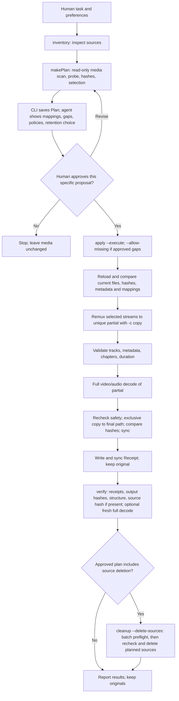
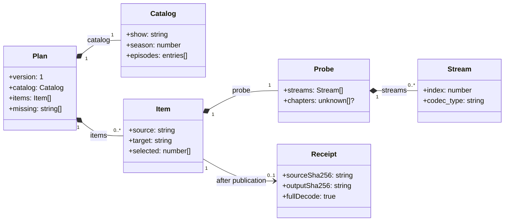

# Video library scripts and types

## Script map and commands

- `scripts/video-library.ts`: CLI. `inventory` prints JSON lines: `{ path, probe }` for each video, `{ ignored }` for other entries. `plan`, `apply`, `verify`, `cleanup` call `scripts/media.ts`.
- `scripts/media.ts`: exported types and helpers, planning, remux, validation, receipts, verification, cleanup. `ffprobe` reads tracks/container/chapters; `ffmpeg` copies tracks or decodes video/audio. Remux only; no lossy encoding.
- `scripts/check-dependencies.ts`: `checkExternalDependencies()` and standalone `bun scripts/check-dependencies.ts`. Checks `ffmpeg -version`, `ffprobe -version`, and `nice -n 0 <current Bun executable> --version`; missing binaries and loader failures produce errors. This checks tool launch, not media compatibility or user approval.
- `scripts/media.test.ts`: unit tests and tiny generated-media integration fixtures, not your library; `beforeAll` requires the checker rather than silently skipping integration tests. `scripts/dependencies.test.ts`: real tools plus isolated subprocess tests for empty `PATH` and an executable returning loader failure.
- `package.json`: `bun run doctor` delegates to `bun run check`: lint → typecheck → all tests, including external dependencies; `bun check --no-script` avoids recursion into package `check`. Normal Bun thread count. `oxlint scripts` for lint.

Run CLI from this skill directory. Source and destination must be existing, disjoint directories.

| Command | Inputs / effect |
| --- | --- |
| `bun scripts/video-library.ts inventory --source /incoming` | Inspect only; one JSON line per entry. |
| `bun scripts/video-library.ts plan --source /incoming --destination /library/show --catalog /run/catalog.json --out /run/plan.json` | Read-only media planning; writes manifest exclusively (`wx`), never replaces one. Prints mappings, gaps, existing/ignored entries and free-space estimate. |
| `bun scripts/video-library.ts apply --plan /run/plan.json --run /run/receipts --execute [--jobs 1] [--allow-missing]` | Publish approved new files. `--allow-missing` required when `Plan.missing` is nonempty. |
| `bun scripts/video-library.ts verify --plan /run/plan.json --run /run/receipts [--full-decode]` | Check receipts, hashes and output structure; optional fresh decode. |
| `bun scripts/video-library.ts cleanup --plan /run/plan.json --run /run/receipts --delete-sources` | Delete planned originals after checks, only if approved plan explicitly includes deletion. |

## Human approval and end-to-end flow

Approval lives in conversation. CLI flags cannot prove consent. `Plan` has no approval field, signature, token, concurrency policy, deletion permission or encoder settings. The proposal must state policy and retention. A different approved policy needs script support before execution. Wait for explicit approval of the specific plan and any gaps. Ask again after revision. `cleanupSources()` does not require proof that a separate `verify` command ran; follow the approved order.

## Six custom types

`Plan`, `Catalog`, `Item`, `Probe`, `Stream` are exported from `media.ts`; `Receipt` is internal. Diagram omits fields listed below. `entries[]` means inline `{ episode: number; title: string }[]`, not a declared custom type. `?` means optional.

| Type | Complete fields and meaning |
| --- | --- |
| `Catalog` | `show: string`, `season: number`: one show/season per plan. `reference: string`: episode-list source; agent researches titles, scripts do not fetch or interpret it. `seasonFolders: boolean`: `true` adds `SEASON N/`, `false` writes directly into destination, including an existing season folder. `episodes: { episode: number; title: string }[]`: full expected season, including destination episodes. |
| `Plan` | `version: 1` (literal manifest version); `sourceRoot: string`, `destinationRoot: string` (resolved disjoint paths); `catalog: Catalog`; `items: Item[]` (new files only); `missing: string[]` (IDs absent from both roots); `existing: string[]` (selected-season destination IDs, untouched); `ignored: string[]` (skipped source entries and other-season destination videos in flat libraries, not excluded tracks); `createdAt: string` (generation time). |
| `Item` | `source: string`, `target: string` (original → proposed output); `title: string` (filename stem and container title); `sha256: string` (source-file fingerprint); `probe: Probe` (source inspection snapshot); `selected: number[]` (**source `Stream.index` values**, not positions in the streams array). |
| `Probe` | `streams: Stream[]`; `format: { duration?: string; tags?: Record<string, string> }` (`duration` is seconds as a string); `chapters?: unknown[]` (validation checks chapter **count only**). FFprobe JSON can carry more fields than the exported type. |
| `Stream` | `index: number`; `codec_type: string` (`video`, `audio`, `subtitle`, `attachment`, etc.); `codec_name: string` (`h264`, `eac3`, `subrip`, etc.); optional `width?: number`, `height?: number`, `channels?: number`, `tags?: Record<string, string>` (language/title), `disposition?: Record<string, number>` (`default`, `forced`, `hearing_impaired`, etc.). |
| `Receipt` | `source: string`, `target: string` (must match `Item`); `sourceSha256: string` (must equal `Item.sha256`); `outputSha256: string` (published output bytes); `fullDecode: true` (literal `true`, not general boolean). |

Example: catalog expects S01E01–S01E03; destination has S01E01; incoming source has S01E02. `Plan.existing = ["S01E01"]`; `Plan.items` has one S01E02 operation; `Plan.missing = ["S01E03"]`. Agent shows the gap and obtains explicit acceptance before `apply --allow-missing`.

## Planning dataflow

`catalogCheck()` validates the catalog; `roots()` checks existing disjoint roots. `scan()` walks sources and selected-season destination; `episodeId()` matches expected IDs. Unknown, duplicate, multi-episode, out-of-catalog or colliding videos stop planning. Planner does not rank duplicate encodes: resolve choices with human. `safeName()` makes standardized titles and targets; `targetSafe()` checks path safety. `probe()` and `sha256()` capture metadata and source bytes; `chooseStreams()` chooses source stream IDs. `makePlan()` rescans files rather than taking saved inventory JSON. 
Stream selection requires primary video and tagged English audio. It keeps English audio and English subtitles, including labeled SDH, and omits other-language tracks. It stops on unknown-language audio/subtitles, ambiguous generic English subtitles, or ASS/SSA subtitles with font attachments that would be dropped. Human decision needed. `ffmpegArgs()` maps `Item.selected` by source indices, uses `-c copy`, retains chapters, sets container title and English track labels; subtitles become neither default nor forced.

Planning changes no media. CLI free-space estimate, not a `Plan` field: `2.2 × total source bytes + 64 MiB`; covers partials coexisting with published copies.

## Apply, verify, cleanup artifacts

`loadPlan()` checks JSON shape and item mappings. `applyPlan()` rebuilds the plan from current files and rejects changed hashes, probes, mappings or completeness. It checks `ffmpeg` and `ffprobe`, free space, then obtains exclusive `apply.lock` in the run directory. `applyPlan()` schedules one worker by default, at most four (`--jobs 1..4`). `work()` processes one item. `ffmpegArgs()` builds arguments for a unique `output.partial.mkv`; `exec()` launches FFmpeg under `nice -n 15`. `validateOutput()` checks count/order/type/codec, video dimensions, audio channels, title, language/disposition, chapter count, duration (within two seconds), then fully decodes video/audio. Before publication, recheck source hash, target safety and destination mount/root. Exclusive copy into final path; compare partial/published SHA-256; sync output and directory; write and sync receipt. Leave originals.

Publication uses an exclusive copy, not an atomic rename. A crash while copying can leave a final-named file without a receipt. Treat it as a collision, not a completed output. Failure stops scheduling new items, but running workers may finish; failed runs may retain partials or published outputs. Inspect interrupted runs before removing a stale lock.

| Run-directory artifact | Use |
| --- | --- |
| `item-<hash>.json` | Receipt; filename hash derives from **source path**, not source bytes. |
| `item-<hash>.log` | Remux and first full-decode commands/output. |
| `verify-<hash>.log` | Fresh decode from `verify --full-decode`. |
| `apply.lock` | Prevents concurrent applies using this run directory. |

`verifyPlan()` matches receipt identity, published output SHA-256 and source SHA-256 when the source remains; checks output structure. Without `--full-decode`, matching output bytes reuse receipt's completed full decode. With it, decode video/audio again. Source and output SHA-256 are distinct: remux changes container, metadata and track set even while keeping selected audio/video packets lossless.

`cleanupSources()` batch-checks every receipt, output hash, source hash and safe path, and syncs outputs/directories before deletion; then rechecks each existing source and removes only planned originals. Already missing sources pass only when matching output and receipt still pass. Cleanup is not transactional. If a source changes or deletion fails during removal, earlier deletions are not rolled back.

Matching SHA-256 proves recorded byte identity. Episode titles, subtitle-language classification and device playback still need reference checks and human judgment.
